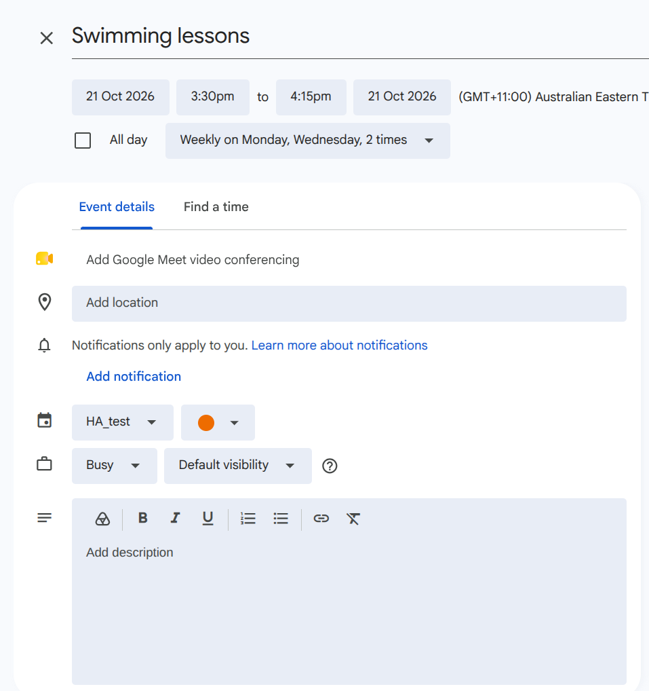
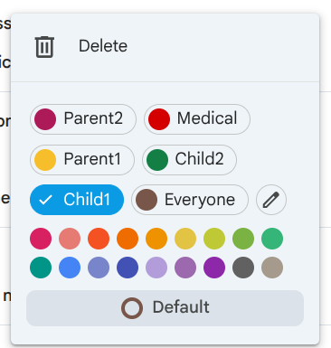
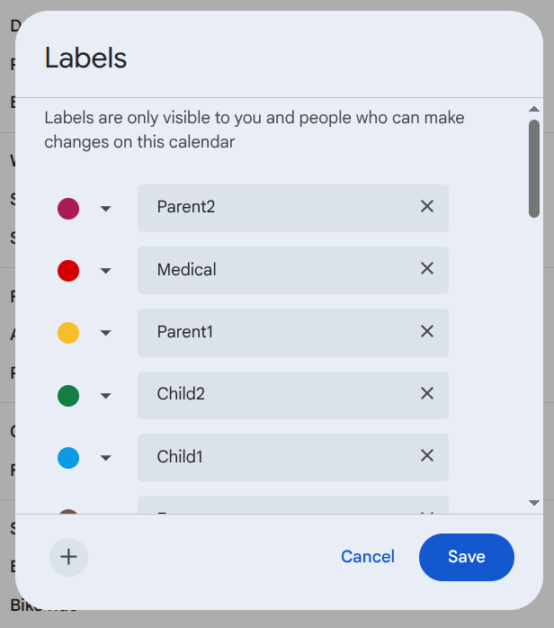
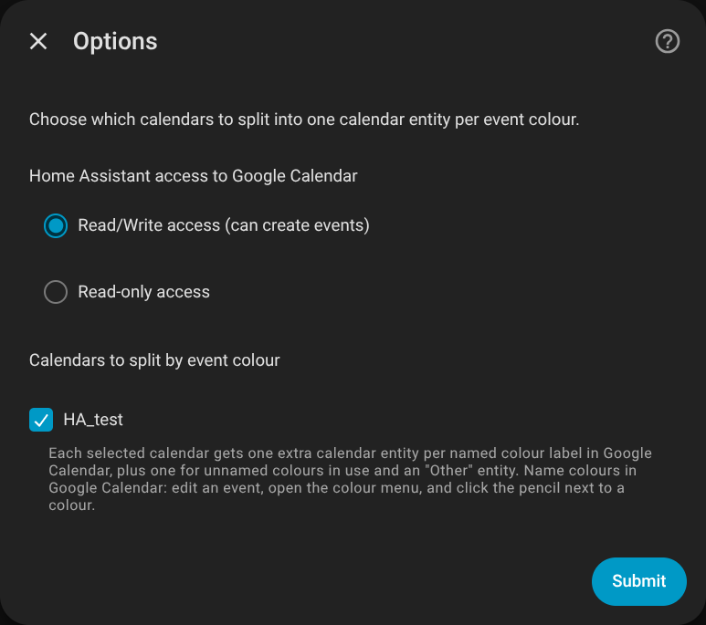
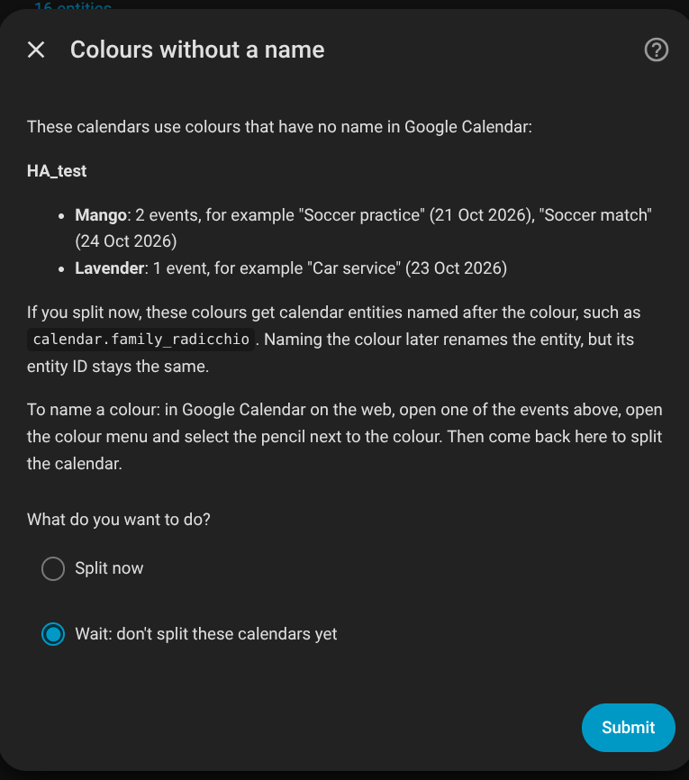
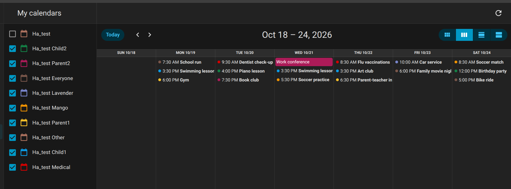
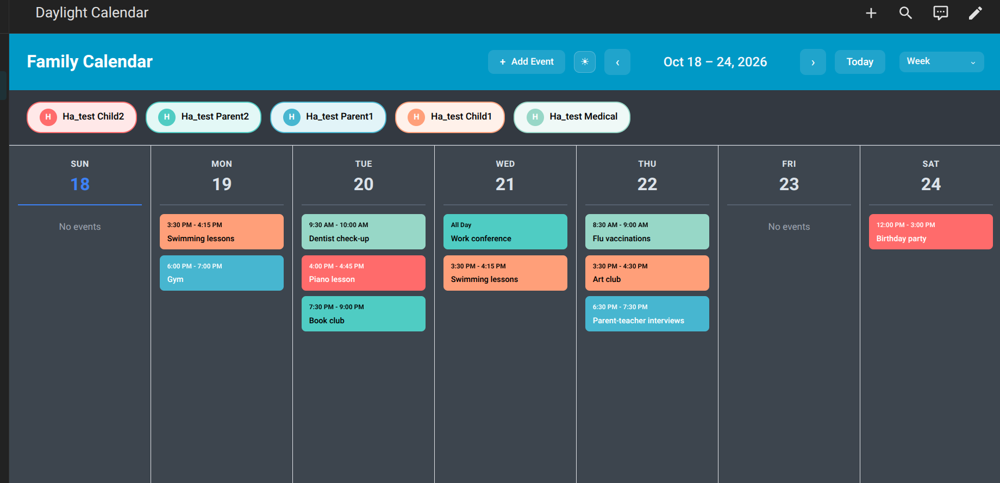
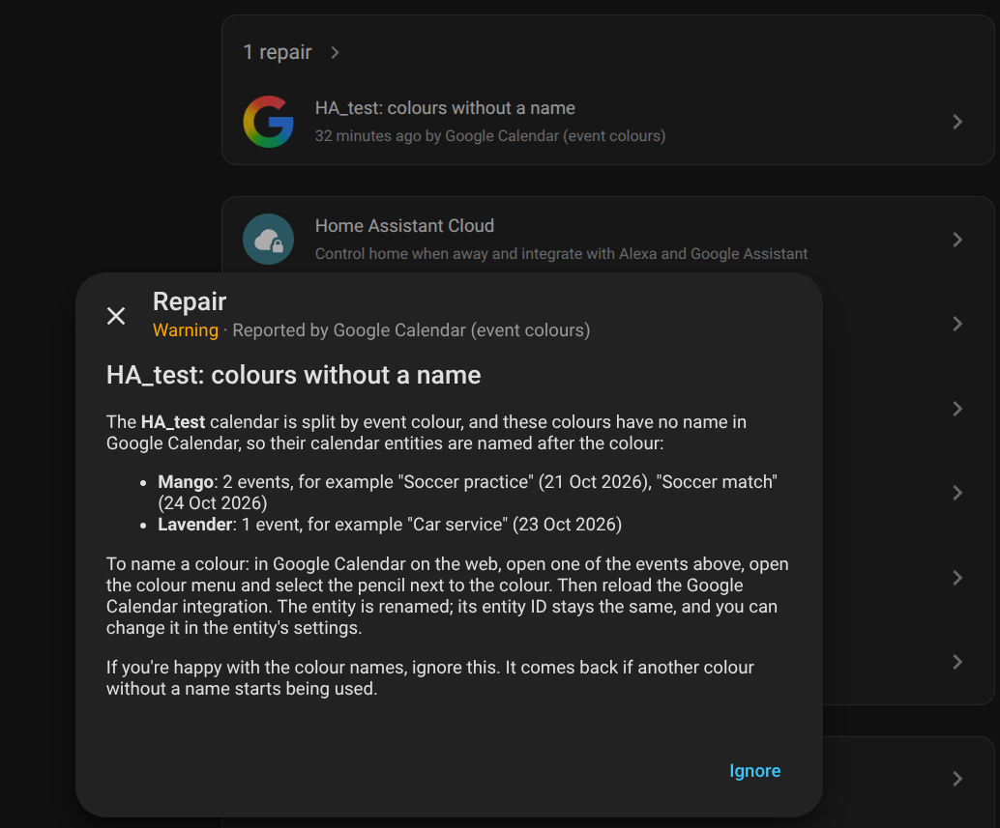

# Google Calendar (event colours)

A custom version of Home Assistant's built-in Google Calendar (`google`) integration. It is based on the core integration at Home Assistant **2026.10.1** and overrides the built-in one when installed. It adds one virtual calendar entity per Google event colour, so dashboard calendar cards can colour events per person or purpose while you keep using a single shared Google calendar.

> [!WARNING]
> **Use at your own risk.** The event colour features (everything listed in [DIFFERENCES_FROM_CORE.md](DIFFERENCES_FROM_CORE.md)) were written by Claude, Anthropic's AI model, using Claude Code. [@Jam3s97](https://github.com/Jam3s97) reviewed and tested them. The rest is Home Assistant's own Google Calendar integration. This project isn't affiliated with or supported by Home Assistant or Google. It can create and delete events in your Google calendars.

**Status:** version 0.1.0, not released yet. Tested in a development Home Assistant 2026.10.1 against real Google calendars (splitting, creating and deleting events, the Repairs issue), plus automated tests. Not yet tried on a production install. The design and the findings behind it are in [plan.md](plan.md).

## Installation

Requirements:

- **Home Assistant 2026.10.1.** This replaces the built-in integration with core's 2026.10.1 code plus the colour features, so on other versions it may not work. It will be updated deliberately for new Home Assistant versions.
- The Google Calendar integration set up as usual (see [Home Assistant's Google Calendar docs](https://www.home-assistant.io/integrations/google/)). Your existing config entry and entities are reused.
- To create events, the integration needs **read/write** access: **Settings > Devices & services > Google Calendar > Configure**.

Steps:

1. In HACS, add this repository as a custom repository (category: Integration).
2. Install **Google Calendar (event colours)** and restart Home Assistant.
3. Home Assistant will log a warning that a custom integration overrides the built-in `google` integration. This is expected.

To go back to the built-in integration, remove it in HACS and restart. Your Google Calendar config entry keeps working; delete the colour entities that are left behind (they show as unavailable).

## Splitting a calendar by colour

### 1. Name your colours in Google Calendar

Google Calendar lets you name each event colour per calendar, for example "Child1", "Medical" or "Everyone". The integration uses these names for its calendar entities, so Google Calendar is the one place where colours are managed.

To name a colour: in Google Calendar on the web, create or open an event on the calendar, open the colour menu, and select the pencil next to a colour. Names belong to each calendar, so name them on the calendar you want to split.

Naming the colours is optional but makes this integration more user friendly. Dad has more meaning than Banana.

  
  
  

*The colour menu in Google Calendar's event editor (left), its named colours and the pencil (middle), and the Labels dialog the pencil opens (right).*

### 2. Choose the calendars to split

In Home Assistant, go to **Settings > Devices & services > Google Calendar > Configure** and tick the calendars to split under **Calendars to split by event colour**.

If a calendar uses colours that have no name yet, you're asked whether to split now or wait (the default). Waiting is usually better: a colour without a name gets an entity named after the colour (such as `calendar.family_radicchio`), and while naming the colour later renames the entity, its entity ID stays the same.

  
  

*Choosing a calendar to split (left), and the question when it uses colours without a name (right).*

### What you get

For a calendar called "Family", alongside the existing `calendar.family`:

| Entity | Events |
|--|--|
| `calendar.family_child1`, `calendar.family_medical`, … | One per named colour: the events with that colour. |
| The entity of the calendar's own colour | Also gets the events left on the calendar's default colour, since that's how they look in Google. For example, if the calendar is Grape and Grape is named "Everyone", uncoloured events show on `calendar.family_everyone`. |
| `calendar.family_radicchio`, … | Colours without a name that events use, named after the colour. |
| `calendar.family_other` | Anything else, such as uncoloured events when the calendar's own colour has no name. |

Every event appears on exactly one colour entity. `calendar.family` is unchanged and still shows everything, so on a dashboard use either `calendar.family` or its colour entities, not both, or each event shows twice. Each colour entity starts with its Google colour as its entity colour, which Home Assistant's calendar page uses.

*Home Assistant's calendar page with a test calendar split by colour: each entity in its Google colour.*

Cards that colour events per entity can use the same split. Some cards pick their own colours per entity rather than using the Google colour; the [Daylight Calendar Card](https://github.com/superdingo101/daylight-calendar-card) is one, where you set the colours in the card's configuration.

*Daylight Calendar Card with five of the colour entities, using the card's own colours.*

When colours in use have no name, a Repairs issue (**Settings > System > Repairs**) lists them with example events, to help you find and name them. After naming colours or changing them in Google, reload the integration to update the entities.

### Creating events with a colour

Home Assistant's create-event dialog has no colour field, so **choose the colour by choosing the calendar**: pick "Family Child1" in the dialog's calendar list, and the event is created in the Family calendar in Google with Child1's colour. The same applies to the `calendar.create_event` and `google.create_event` actions and to dashboard cards that create events.

- Events created on `calendar.family`, or on the entity of the calendar's own colour, get no colour, so they follow the calendar's default colour.
- `calendar.family_other` can't create events when the calendar's own colour has a name (an uncoloured event would show on that colour's entity instead).
- Deleting an event from a colour entity deletes it from the Google calendar.

### Limitations

- An event has one colour, so it appears on one colour entity. For events involving several people, use a shared colour such as "Everyone".
- Events can be created and deleted, not edited (the same as core). To change an event's colour, change it in Google.
- The calendar's own colour is a per-account setting in Google. The integration uses the colour of the Google account Home Assistant is signed in with.
- A colour entity's state (its current or next event) only looks at the calendar's next 20 events, so a colour with no event among them shows as off. Calendar cards and the calendar page aren't affected.

## Relationship to core

`custom_components/google/` was copied from [home-assistant/core](https://github.com/home-assistant/core/tree/2026.10.1/homeassistant/components/google) at tag `2026.10.1`. Commit `6ce6cd2` holds that copy unchanged, so `git diff 6ce6cd2 -- custom_components/google` shows everything this project changes.

Every difference from core, and why it was made, is listed in [DIFFERENCES_FROM_CORE.md](DIFFERENCES_FROM_CORE.md), along with the steps for upgrading to a new core version.

## CI

- **Hassfest** passes, with one expected warning: "Domain collides with built-in core integration". Overriding `google` is deliberate, because it reuses the existing OAuth config entry.
- **HACS validation** ignores `brands`, since this repo has no brand images. It also checks GitHub repository settings: the repo needs a description and topics.
- **Lint** (ruff) and **Test** (pytest) run on every push and pull request.

## Development

Open the repo in the devcontainer and run `scripts/develop` to start a dev Home Assistant (2026.10.1) on port 8123. Run the tests with `python3 -m pytest`.

This repository was scaffolded from [ludeeus/integration_blueprint](https://github.com/ludeeus/integration_blueprint).

## License

Apache License 2.0 (see [LICENSE](LICENSE)), the same as [Home Assistant core](https://github.com/home-assistant/core), which `custom_components/google/` and `tests/components/google/` are based on. The repository scaffolding comes from integration_blueprint under the MIT License; its notice is in [NOTICE](NOTICE).
